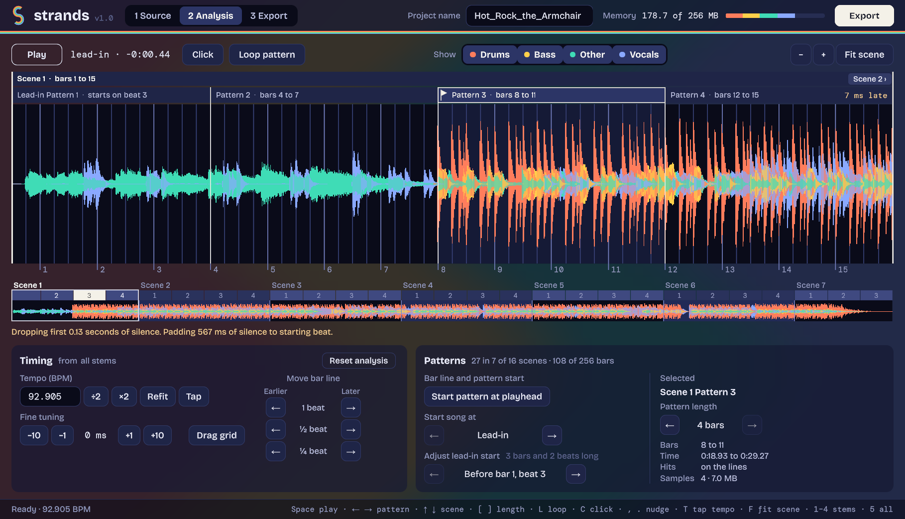
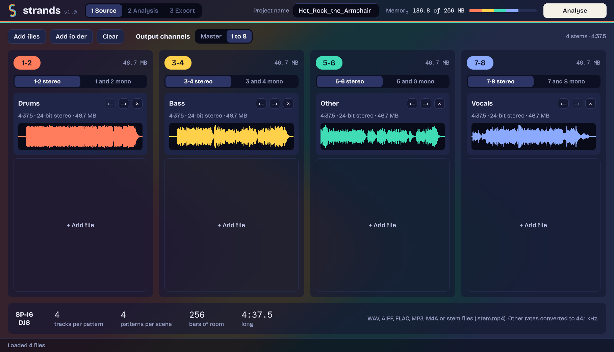
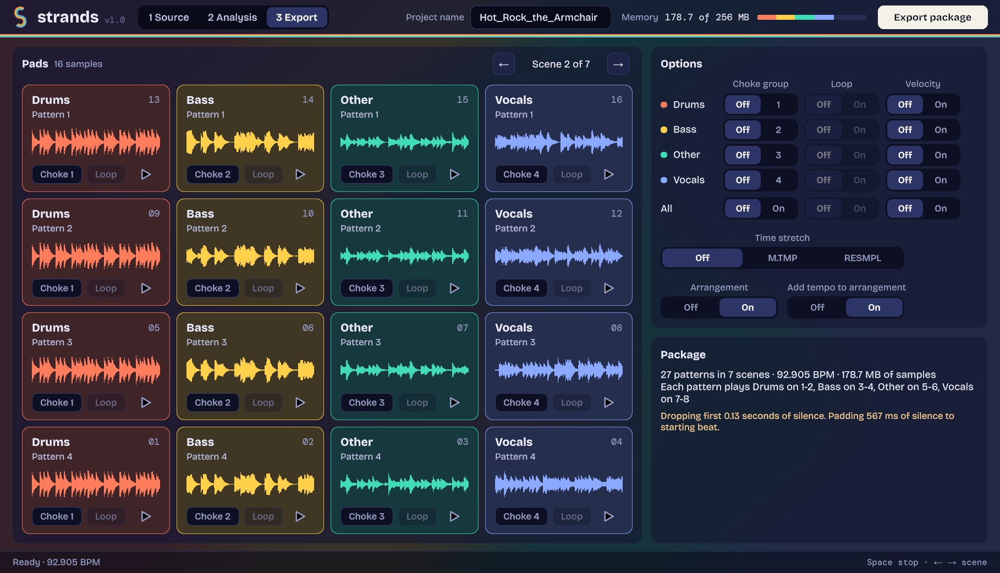

# Strands

## Overview

Strands is a macOS and Windows application, with an untested Linux build, that turns a song into a project for the Pioneer DJ Toraiz SP-16 and the DJS-1000. Load a full mix, or the song split into stems, and Strands finds the beat grid, cuts the audio into patterns on the bar lines and writes a `.tpkg` package; on the SP-16 it plays the whole song from the arranger. Stems can each go to their own output pair, ready for separate channels on a mixer, or all to the master output.

## Features

- **Songs or stems** — load one file as a full song, or up to 16 stems as separate files, a folder of them, or a stem file (`.stem.mp4`)
- **Audio formats** — WAV, AIFF, FLAC, MP3 and M4A/MP4 (AAC), mono or stereo; 48 kHz and other sample rates are converted to 44.1 kHz
- **Beat grid analysis** — tempo, bar lines and where the drums come in, found from the audio; with stems, every stem is analysed and the best fitting grid is used
- **Alignment tools** — move the bar line by a beat or part of one, fine-tune in milliseconds, tap tempo, start a pattern at the playhead, and choose where the song starts
- **Audition** — play the song with a click on the beat, loop a pattern, and switch stems on and off
- **Outputs** — four output strips for outputs 1-2, 3-4, 5-6 and 7-8, a single output as mono, or everything on master
- **Pads** — see each scene's sixteen pads as the unit lays them out, play them, and set choke groups and loops per stem or per pad, and velocity per stem
- **Unit settings** — time stretch (Off, M.TMP, RESMPL), arranger on or off, and whether the arrangement carries the song's tempo, remembered from one song to the next
- **Memory aware** — shows how much of the unit's 256 MB of sample memory the package will use, and leaves out samples that are silent

## Screenshots

**Source** — load a song or its stems onto four output strips.

**Export** — each scene's sixteen pads as the unit lays them out, with the package's options.

## Getting Started

1. Download and extract the macOS, Windows or Linux release (the Linux build is untested) [here](https://github.com/ezoray/Strands/releases/latest)
2. Run Strands, and add a song or its stems with **Add files**
3. Press **Analyse**, check the grid against the click, and adjust if needed
4. Go to **Export**, set the options, and press **Export package**
5. Copy the `.tpkg` to the SP-16 or DJS-1000 and load it

On macOS, a downloaded copy is stopped the first time it opens because it is not notarised. Allow it once in **System Settings > Privacy & Security > Open Anyway**.

For everything else, the user guide included with the release covers the app in full detail.

## Your Music

Use Strands with music you own or have the rights to use. Buying a track usually gives you a licence for personal use; packages, stems and samples made from commercial music are for your own performance and should not be shared or distributed. Strands cannot read copy-protected files.

## Building from Source

The project is built with Unity 6000.6.4f1. Everything it needs is in the repository: clone it, open it in Unity, and build from **File > Build Profiles**.

The tests are NUnit Edit Mode tests in `Assets/Tests`, run from Unity's Test Runner.

## Dependencies

- Unity 6
- [NLayer](https://github.com/naudio/NLayer) (MP3 decoding, included with two fixes)
- [SharpJaad](https://github.com/jimm98y/SharpJaad) (AAC decoding, included with one fix)
- [StandaloneFileBrowser](https://github.com/gkngkc/UnityStandaloneFileBrowser) (native file dialogs, included with a universal macOS plugin)
- Bricolage Grotesque and DM Mono fonts

See [THIRD_PARTY_NOTICES.txt](THIRD_PARTY_NOTICES.txt) for their licences.

## Licence

Strands is released under the [MIT License](LICENSE).

Strands is not affiliated with, endorsed by or sponsored by AlphaTheta Corporation or Pioneer DJ. Toraiz, SP-16 and DJS-1000 are trademarks of their respective owners.

## AI Disclosure

Code and documentation written by Claude Code (Anthropic). Designed and rigorously tested by a lowly human (we're cooked).
